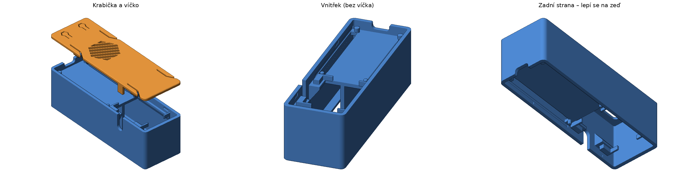
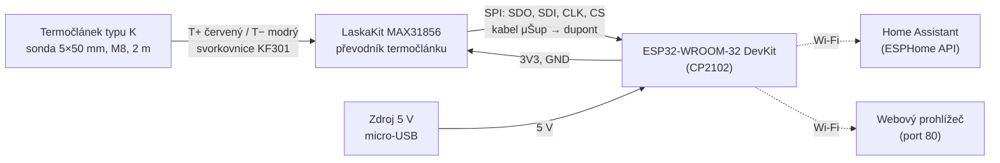

# Krbový teploměr

Wi-Fi teploměr pro vysoké teploty postavený na ESP32 a převodníku **MAX31856** s **termočlánkem typu K**. Měří teplotu krbové obestavby (nebo čehokoli do cca 600 °C podle použité sondy) a hodnotu posílá do **Home Assistantu** přes [ESPHome](https://esphome.io). Elektronika je uložená v 3D tištěné krabičce, která se lepí zadní stranou na zeď.



## Funkce

- měření teploty termočlánkem typu K, převod a kompenzace studeného konce v obvodu MAX31856,
- odečet každých 5 s, rozlišení 0,1 °C, filtr síťového rušení 50 Hz,
- integrace do Home Assistantu přes nativní ESPHome API (senzor `Teplota krbové obestavby`, třída `temperature`, `measurement`),
- vestavěný webový server na portu 80 (aktuální hodnota a logy v prohlížeči),
- aktualizace firmwaru přes Wi-Fi (OTA),
- napájení 5 V přes micro-USB konektor ESP32.

## Součástky

| Ks | Součástka | Poznámka |
|---:|-----------|----------|
| 1 | [IoT ESP-WROOM-32 DevKit, CP2102](https://www.laskakit.cz/en/iot-esp-32s-2-4ghz-dual-mode-wifi-bluetooth-rev-1--cp2102/) | 38 pinů (2 × 19), micro-USB, deska 55 × 29 mm |
| 1 | [LaskaKit MAX31856 – univerzální převodník pro termočlánky](https://www.laskakit.cz/en/univerzalni-modul-prevodniku-pro-termoclanky--max31856--spi/) | SPI, napájení 3,0–3,6 V, deska 30 × 24 mm |
| 1 | [Termočlánek typu K, 600 °C, sonda 5 × 50 mm, M8, kabel 2 m](https://www.laskakit.cz/en/termoclanek-typu-k-600c-5x50mm-m8-2m/) | |
| 1 | [Kabel μŠup SPI (JST-SH 6 pin) – dupont samice](https://www.laskakit.cz/en/--sup-spi-jst-sh-6-pin-kabel-dupont-samice/) | propojení MAX31856 ↔ ESP32 |
| 1 | [Šroubovací svorkovnice do DPS KF301-2P](https://www.laskakit.cz/en/sroubovaci-svorkovnice-do-dps-kf301-2p/) | připájená na MAX31856 |
| 1 | Krabička a víčko (3D tisk) | [`hardware/enclosure`](hardware/enclosure) |
| 1 | Napájecí zdroj 5 V s micro-USB kabelem | |
| – | Oboustranná lepicí páska nebo lepidlo | montáž na zeď |

## Blokové schéma



## Zapojení

### MAX31856 ↔ ESP32

| MAX31856 | Barva vodiče | ESP32 | Funkce |
|----------|--------------|-------|--------|
| VCC | červený | 3V3 | napájení 3,3 V |
| GND | černý | GND | zem |
| SDO | modrý | GPIO19 | SPI MISO |
| SDI | bílý | GPIO23 | SPI MOSI |
| CLK | žlutý | GPIO18 | SPI SCK |
| CS | zelený | GPIO27 | výběr čipu |

GPIO18, 19 a 23 jsou výchozí piny sběrnice VSPI na ESP32. Modul MAX31856 snese napájení jen 3,0–3,6 V, proto ho připojte na **3V3**, nikdy na 5 V.

> [!WARNING]
> Na desce LaskaKit IoT ESP-WROOM-32 je podle prodejce chybně popsaný jeden pin: popisek **GND** pod pinem **5V** ve skutečnosti patří pinu **CMD**. Zem zapojujte podle obrázku pinoutu v galerii produktu, ne podle potisku desky.

### Termočlánek ↔ MAX31856

| Vodič termočlánku | Svorka MAX31856 |
|-------------------|-----------------|
| červený | T+ |
| modrý | T− |

Polarita je ověřená v praxi s uvedeným termočlánkem: **červený vodič patří na T+**. Barevné značení termočlánků se ale u různých výrobců liší. Pokud teplota při zahřívání sondy klesá, prohoďte vodiče ve svorkovnici.

## Firmware (ESPHome)

Konfigurace je v [`firmware/krbovy-teplomer.yaml`](firmware/krbovy-teplomer.yaml). Přístupové údaje k Wi-Fi se načítají ze souboru `secrets.yaml`, který do repozitáře nepatří.

```bash
cd firmware
cp secrets.yaml.example secrets.yaml   # doplňte SSID a heslo
esphome run krbovy-teplomer.yaml       # první nahrání přes USB, další už přes Wi-Fi
```

Konfigurace je ověřená příkazem `esphome config` ve verzi ESPHome 2026.10.1.

Po připojení k síti Home Assistant zařízení sám nabídne v *Nastavení → Zařízení a služby*. Webové rozhraní je dostupné na `http://krbovy-teplomer.local/`.

Doporučená, ale volitelná úprava je zapnout šifrování API (`api: encryption: key: !secret api_key`) a heslo pro OTA. Klíč pak zadáte při přidávání zařízení do Home Assistantu.

## Krabička

Krabička je remix modelu [ESP32-WROOM-32 (USB-C) Box with Lid](https://www.printables.com/model/711587-esp32-wroom-32-usb-c-box-with-lid) od autora **PLAUK** (licence CC BY 4.0), podrobnosti jsou v části [Licence a autorství](#licence-a-autorství). Zachovaný zůstal konec u USB (výřez pro konektor, sloupky na této straně, zaklapávací víčko s mřížkou a otvory pro tlačítka EN a BOOT). Přibylo:

- úprava části pro ESP32 na delší desku 55 × 29 mm: prostor prodloužený o 4 mm a v úrovni desky rozšířený na 29,9 mm, vzdálenější sloupky posunuté na rozteč 51 mm (zúžené na 2,2 mm kvůli nepřesnosti měření) a spáry prodloužené pro 2 × 19 pinů,
- prodloužení o dalších 40 mm s oddílem pro modul MAX31856, který se vkládá **lícem dolů** (svorkovnice a konektor visí do kabelového prostoru),
- kabelový prostor pod ESP pro dupont konektory (20 mm) a ohyb vodičů; zadní strana je otevřená a má lepicí lem 4 mm a středové žebro,
- výřez pro kabel termočlánku v pravé boční stěně (při pohledu shora s USB k sobě) a jazýček ve víčku, který výřez uzavře na otvor 5,5 × 5 mm,
- druhý pár zaklapávacích západek a přítlačné kolíky ve víčku, které drží modul MAX31856.

Rozměry: 33,1 × 100,8 × 31,2 mm, s víčkem asi 33 mm.

### Tisk

| Soubor | Orientace | Podpěry |
|--------|-----------|---------|
| [`enclosure_box.stl`](hardware/enclosure/enclosure_box.stl) | zadní (otevřenou) stranou na podložku, tak jak je uložen | jen od podložky, pod policí pro ESP |
| [`enclosure_lid.stl`](hardware/enclosure/enclosure_lid.stl) | otočit horní plochou na podložku | nejsou potřeba |

Krabička bude v blízkosti krbu, proto doporučujeme **PETG nebo ASA**, protože PLA měkne už kolem 55 °C. Do horka patří jen sonda termočlánku. Krabici umístěte tam, kde je teplota stabilní a nepřekračuje běžné pokojové hodnoty: kompenzace studeného konce měří teplotu přímo na modulu MAX31856.

### Montáž

1. ESP32 s nasazenými dupont kabely vložte USB konektorem do výřezu na čele krabičky. Piny projdou spárami do kabelového prostoru.
2. Kabel termočlánku připojte do svorkovnice (červený T+, modrý T−) a dotáhněte. Šroubky svorkovnice budou po vložení modulu mířit ke zdi.
3. Modul MAX31856 vložte lícem dolů na boční police tak, aby svorkovnice mířila k výřezu v pravé stěně. Kabel termočlánku vložte shora do výřezu.
4. Kabel μŠup připojte k modulu a dupont konce k ESP32 podle tabulky zapojení. Vodiče veďte kabelovým prostorem.
5. Nasaďte víčko, zacvakne se na čtyřech západkách. Při otevírání stlačte pružná raménka na bocích.
6. Krabičku přilepte zadní stranou na zeď (lem a žebro). USB konektor zůstane přístupný na čele.

### Úpravy modelu

Modely generuje skript [`hardware/enclosure/build_enclosure.py`](hardware/enclosure/build_enclosure.py) z originálních STL v [`hardware/enclosure/original`](hardware/enclosure/original). Rozměry modulu, délky dupont konektorů, polohu výřezu a další hodnoty lze změnit v parametrech na začátku skriptu.

```bash
cd hardware/enclosure
pip install -r requirements.txt
python build_enclosure.py
```

## Struktura repozitáře

```
krbovy-teplomer/
├── README.md
├── LICENSE                     # CC BY-SA 4.0 (3D modely, dokumentace, obrázky)
├── LICENSE-CODE                # MIT (firmware a skripty)
├── docs/img/enclosure.png
├── firmware/
│   ├── krbovy-teplomer.yaml    # konfigurace ESPHome
│   └── secrets.yaml.example
└── hardware/enclosure/
    ├── README.md               # autorství a seznam změn modelu
    ├── enclosure_box.stl       # krabička
    ├── enclosure_lid.stl       # víčko
    ├── build_enclosure.py      # generátor modelů
    ├── requirements.txt
    └── original/               # původní model (CC BY 4.0)
        ├── Box.stl
        └── Lid.stl
```

## Licence a autorství

**Krabička** je odvozené dílo modelu **„ESP32-WROOM-32 (USB-C) Box with Lid“**, jehož autorem je **PLAUK**. Model je zveřejněný na Printables (<https://www.printables.com/model/711587-esp32-wroom-32-usb-c-box-with-lid>) pod licencí [Creative Commons Uveďte původ 4.0 Mezinárodní (CC BY 4.0)](https://creativecommons.org/licenses/by/4.0/). Původní soubory jsou beze změn v [`hardware/enclosure/original`](hardware/enclosure/original) a vztahuje se na ně licence originálu. Seznam provedených změn je v [`hardware/enclosure/README.md`](hardware/enclosure/README.md).

Licence projektu:

- **3D modely, dokumentace a obrázky** jsou pod licencí [Creative Commons Uveďte původ-Zachovejte licenci 4.0 Mezinárodní (CC BY-SA 4.0)](https://creativecommons.org/licenses/by-sa/4.0/), úplné znění je v [`LICENSE`](LICENSE). Licence CC BY 4.0 původního modelu umožňuje šířit úpravy pod CC BY-SA 4.0, pokud je zachováno uvedení autora originálu.
- **Firmware (ESPHome konfigurace) a skripty** jsou pod licencí [MIT](LICENSE-CODE), protože licence Creative Commons nejsou určené pro software.

Projekt nemá žádnou vazbu na výrobce použitých součástek ani na autora původního modelu.
